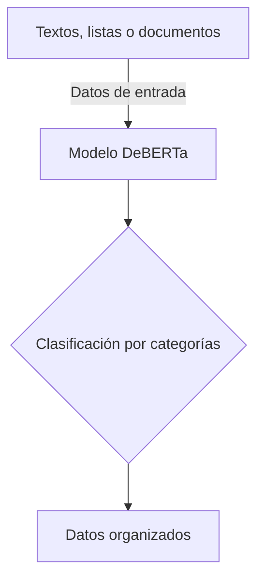

# Proyecto integrador 1° parcial

> IA organizadora de datos para estudiantes y trabajadores

**Proyecto integrador · Herramientas de IA**

**Grupo:** 1°B · **Equipo:** 67

## 👥 Integrantes

| Nombre completo | Matrícula |
|:---:|:---:|
| Mariano Hernández Antuñano | 198549-5 |
| Javier Emilio Aranda Espinoza | 198581-9 |
| Alexa Gonzalez Del Castillo Torres | 198373-0 |
| Paola Bocanegra Tellez | 198088-1 |

## 1. Caso de uso

Una IA organizadora de datos ayuda a estudiantes o trabajadores a clasificar y ordenar grandes cantidades de información de forma rápida. El modelo analiza la información y la organiza por categorías, temas o prioridades.

- **Entrada:** El usuario proporciona datos desordenados, como textos, listas o documentos.
- **Salida:** El usuario recibe los datos estructurados y fáciles de consultar, ahorrando tiempo y esfuerzo.

## 🔀 Cómo funciona

## 2. Modelo abierto elegido

| Dato | Respuesta |
|:---:|:---|
| Identificador | [MoritzLaurer/deberta-v3-base-zeroshot-v2.0](https://huggingface.co/MoritzLaurer/deberta-v3-base-zeroshot-v2.0) |
| Tarea (pipeline tag) | `zero-shot-classification` |
| Número de parámetros | ~0.2 mil millones (200,000,000) |
| Licencia | El modelo base se publicó bajo la licencia MIT. |
| Limitación o sesgo declarado | El modelo solo puede realizar tareas de clasificación de texto. Los sesgos pueden provenir del modelo base subyacente, de los datos de entrenamiento NLI humanos y de los datos sintéticos generados por Mixtral. |

## 3. Viabilidad de hardware

$$
\text{Memoria mínima} = N \times 2\ \text{bytes (FP16)}
$$

- **VRAM disponible en Colab:** 14.6 GB (GPU NVIDIA Tesla T4).
- **Dónde se ejecuta:** Colab con GPU.
- **Por qué:** Se verificó que el modelo es viable para ejecutarse en Colab con GPU, sin necesidad de utilizar una API de inferencia externa.

## 4. Riesgo ético

- **Riesgo:** La IA podría interpretar mal la información o inventar datos, por ejemplo, crear tareas o eventos que el usuario nunca mencionó.
- **Mitigación:** El sistema debe marcar la información generada por la IA y permitir que el usuario la revise antes de guardarla.

![[MODELCARD.png]]

